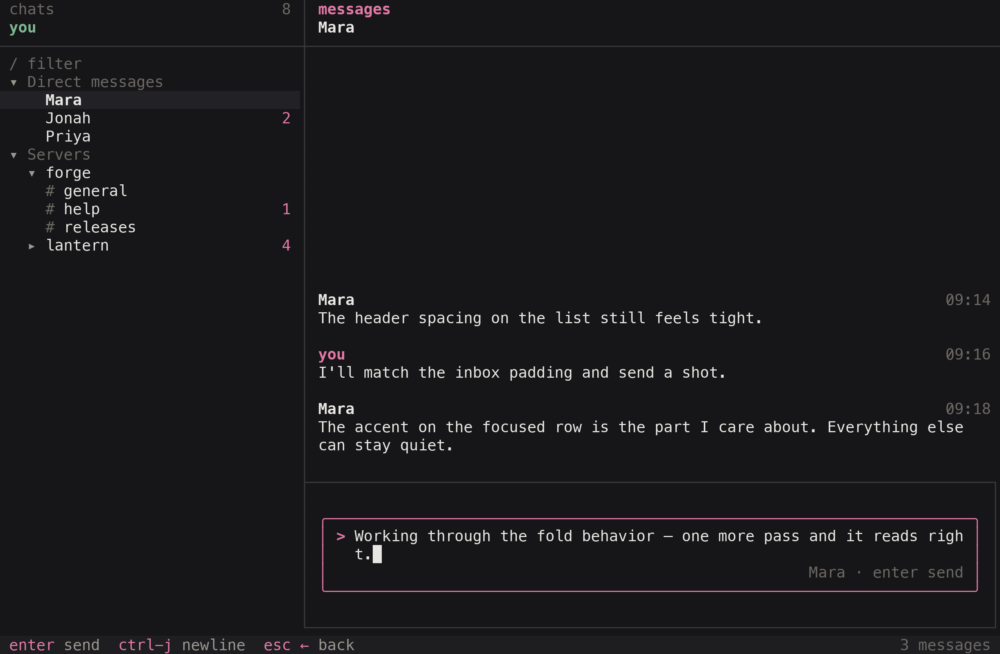

# dt

A full-screen terminal client for Discord chats. The left column is direct messages, then servers and their text channels. The right column is the open conversation. The writing pane stays pinned under the history. Inside it, a prompt takes the message: a `>` on the first line, and the chat name along the bottom. That prompt highlights while it is focused.



The chrome matches inbox and ot: neutral dark surfaces, a magenta accent, a one-cell divider, and a hint line along the bottom.

`dt` signs in as your Discord account. It lists your servers, their text and announcement channels, and your direct messages — the same set the Discord apps show. Voice, threads, members, and reactions are out of scope.

## Status

This project exists for research and experimentation — a way to study how Discord's gateway and REST interfaces behave from a terminal. It is not affiliated with, endorsed by, or connected to Discord.

Discord's terms of service do not allow third-party clients, automation, or self-bots on user accounts. Running `dt` with an account token violates those terms, and Discord can suspend an account it detects doing it. Treat this as a research artifact, not software for daily use, and understand that risk before pointing `dt` at any account you care about.

## Sign in

`dt` needs an account token. There is no portal step; the token comes from a Discord client you are already logged into. The easiest source is the web app in a desktop browser:

1. Open <https://discord.com/app> in a desktop browser and sign in.
2. Press `F12` (or `cmd-option-i`) to open DevTools, then the **Console** tab.
3. Paste this and press enter. Discord may ask you to type `allow pasting` first:

```js
window.m=[];webpackChunkdiscord_app.push([[Math.random()],{},e=>{for(const c in e.c)window.m.push(e.c[c])},window.m=[]]);window.m.filter(x=>typeof x?.exports?.default?.getToken==="function").map(x=>{try{return x.exports.default.getToken()}catch{return null}}).filter(t=>typeof t==="string"&&/^[A-Za-z0-9_-]+\.[A-Za-z0-9_-]+\.[A-Za-z0-9_-]+$/.test(t))[0]
```

It prints the token string. If it prints `undefined`, you are signed out in that browser — sign in and run it again.

The desktop app works too, but its DevTools are gated: set `"DANGEROUS_ENABLE_DEVTOOLS_ONLY_ENABLE_IF_YOU_KNOW_WHAT_YOURE_DOING": true` in `~/Library/Application Support/discord/settings.json`, restart, and use the same snippet in `ctrl-shift-i`.

```sh
dt login
```

Paste the token when asked. A leading `Bot ` is stripped, but a bot token will not work — this client signs in as your account. The token is stored at `~/.config/discord-tui/token` (or `$XDG_CONFIG_HOME/discord-tui/token`) with mode `0600`. `DISCORD_TOKEN` overrides the file.

Treat the token like a password: anyone who has it has your account. Resetting your password invalidates it.

```sh
dt
dt logout
dt help
```

`just run` builds the release binary and opens the client. Quit a running `dt` before you start the new binary.

## Run

```sh
just build
./target/release/dt
```

## The screen

`tab` moves between the chat list, the history, and the composer. `h`, `l`, and the arrow keys fold a section or a server, and move across when there is nothing to fold. Opening a chat loads its recent messages. Scrolling to the top loads older ones. What you send is posted to Discord. Unread counts are for this session.

Press `?` for the key list. `q` quits from the list or the history. `ctrl-c` quits from anywhere, including the composer.

## Keys

| | |
| --- | --- |
| Move | `↑` `↓` `j` `k` |
| Page | `pgup` `pgdn` `ctrl-u` `ctrl-d` |
| Top / bottom | `g` `G` |
| Panes | `tab` `h` `l` or `←` `→` |
| Fold | `space`, or `←` `→` on a section or server |
| Open, or send | `enter` |
| New line | `ctrl-j` in the composer |
| Leave the composer | `esc` or `←` |
| Filter chats | `/` |
| Copy the latest message | `y` |
| Back, or clear the filter | `esc` |
| Help | `?` |
| Quit | `q` from the list or the history, `ctrl-c` anywhere |

`/` filters the list on this machine. `enter` keeps the filter and returns to the list. `esc` clears it. A query that matches a channel shows that channel under its server, even when the server is folded.

Click a row to open it. The scroll wheel moves the list or the history under the pointer. Each chat keeps its own unsent draft.

Copy uses `pbcopy` on macOS and also OSC 52. The text is saved to `~/.discord-tui/last-copy.txt`.
